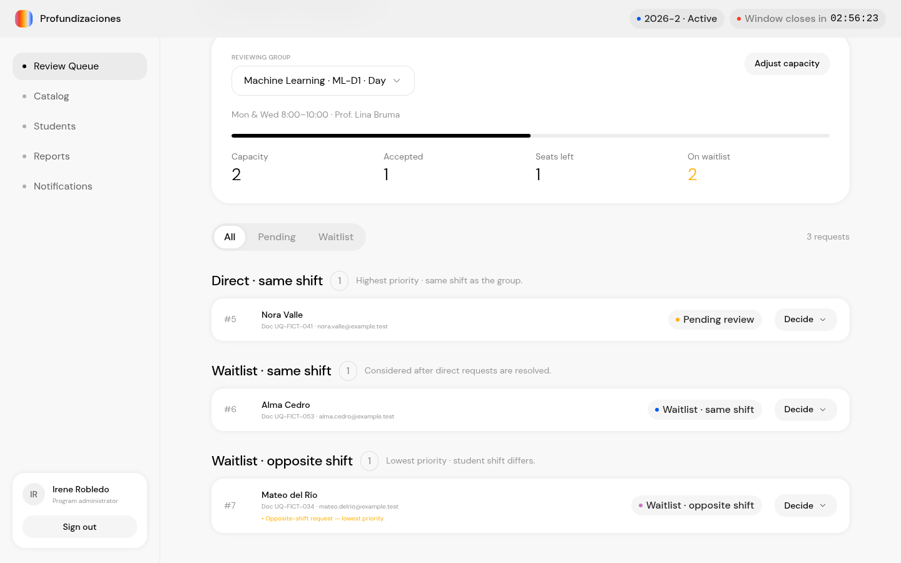
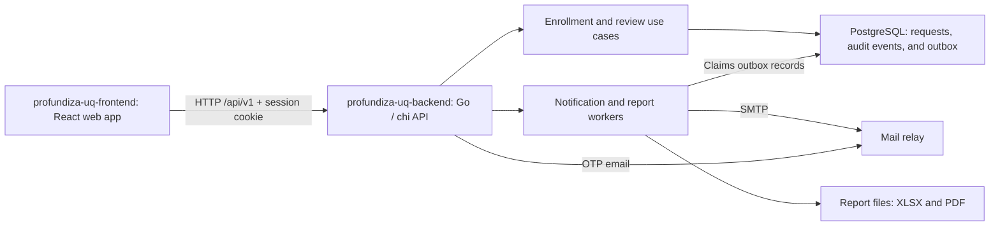

<!-- markdownlint-disable-next-line MD041 -->
<div align="center">

<h1>Profundiza UQ · API</h1>

<p><strong>Capacity, arrival order, and review for professional electives at Universidad del Quindío.</strong></p>

<p>
<a href="https://github.com/diegnghtmr/profundiza-uq-backend/actions/workflows/ci.yml"></a>


<a href="LICENSE"></a>
</p>

<p>
<a href="https://diegnghtmr.me/en/work/profundiza-uq/"><strong>Case study</strong></a> &bull;
<a href="#quick-start"><strong>Quick start</strong></a> &bull;
<a href="#architecture"><strong>Architecture</strong></a> &bull;
<a href="https://github.com/diegnghtmr/profundiza-uq-frontend"><strong>Frontend repo</strong></a>
</p>

</div>

<p align="center"></p>

<p align="center"><em>The API classifies requests and supplies the capacity and priority tiers shown in the staff queue.</em></p>

Two students can request the last direct review slot at the same time. Profundiza UQ locks the group before counting its occupied slots and records arrival order in PostgreSQL. Students can see whether a request is awaiting review or waitlisted, while staff review the queue one offering group at a time.

## Features

- **Passwordless sign-in.** Email one-time codes, issue HttpOnly session cookies, and authorize API routes by role.
- **Enrollment windows.** Publish periods, electives, prerequisites, groups, and capacities before accepting requests.
- **Capacity-safe submissions.** Lock the offering group while assigning direct or waitlist priority, with a server-generated arrival sequence.
- **Group-scoped review.** Order requests by priority and arrival, and record decisions with a reason.
- **Audited changes and notifications.** Record enrollment changes and enqueue email in the database transaction; a worker sends messages after commit.
- **Reports and administration.** Manage student records, administrator access, global settings, and background report exports.

## Quick start

Use Go **1.26**, a running PostgreSQL server (CI uses **16**), and a local SMTP relay such as Mailpit to read sign-in emails. Create an empty database and give the API's connection account permission to apply migrations. This checkout ships a [Dockerfile](Dockerfile) for the API, not a Compose stack.

```sh
git clone https://github.com/diegnghtmr/profundiza-uq-backend.git
cd profundiza-uq-backend
export APP_ENV=development
export COOKIE_SECURE=false
export DATABASE_URL='postgres://<user>:<password>@localhost:5432/profundiza_uq?sslmode=disable'
export SMTP_ADDR=localhost:1025
go run ./cmd/api
```

Replace the database placeholders before running the API. It applies its embedded migrations on startup. Open <http://localhost:8080/healthz> or <http://localhost:8080/readyz>; application routes live under `/api/v1`. To try the student and review flows, apply [dev_seed.sql](seed/dev_seed.sql) to the migrated **development database only**, then use one of the supplied demo email accounts in the companion frontend. For PostgreSQL in Docker, the [Makefile](Makefile) provides `make seed` with `DB_CONTAINER`, `DB`, and `DB_USER` overrides.

| Variable | Purpose | Default |
| --- | --- | --- |
| `APP_ENV` | Runtime profile: `development`, `staging`, or `production`. Unknown values are rejected. | `production` |
| `HTTP_ADDR` | HTTP listen address. | `:8080` |
| `DATABASE_URL` | PostgreSQL connection URL. | Local development database; provide your own credentials |
| `COOKIE_SECURE` | Require HTTPS for the session cookie; can be `false` only in development. | `true` |
| `ALLOWED_EMAIL_DOMAINS` | Comma-separated sign-in allow-list and fallback for the runtime domain setting; required outside development. | Empty |
| `SESSION_TTL`, `OTP_TTL` | Session lifetime and code expiry. | `12h`, `10m` |
| `SMTP_ADDR`, `MAIL_FROM` | SMTP relay address and sender. Development also logs the code; non-development does not. | `localhost:1025`, `no-reply@profundiza-uq.edu.co` |
| `REPORTS_OUTPUT_DIR` | Writable directory for generated files. | `./reports-output` |

See [env.example](env.example) for the full local example. Configuration is read from the process environment; copying the example alone does not export variables. For staging or production, keep `COOKIE_SECURE=true` and configure `ALLOWED_EMAIL_DOMAINS`, or startup fails.

## Architecture

The Go process follows `adapter → app → domain`; `cmd/api` wires HTTP, PostgreSQL, and worker adapters. The enrollment domain owns classification, decisions, and enrollment limits. PostgreSQL row locks serialize updates to a group's capacity, and an advisory lock coordinates migrations.



### Modules

| Module | API surface under `/api/v1` |
| --- | --- |
| Identity | `/auth/login/start`, `/auth/login/verify`, `/auth/logout`, `/me` |
| Semesters and windows | `/semesters`, `/enrollment-windows` |
| Catalog | `/offerings`, offerings' groups and prerequisites, `/electives`, `/offering-groups` and capacity adjustments |
| Enrollment | `/enrollment-requests`, `/enrollment-requests/batch`, a request's detail and `/cancel` |
| Review | `/admin/review-queues`, `/admin/enrollment-requests/{id}/decisions` |
| Notifications and reports | `/notifications`, mark-read actions, `/reports`, and report downloads |
| Students | `/students`, `/students/import`, and academic records; import accepts JSON, not multipart uploads |
| Administration and audit | `/admin/users`, `/admin/global-settings`, `/audit-events` |

## Tech stack

| Layer | Technology |
| --- | --- |
| Runtime and HTTP | Go 1.26, chi, `log/slog` |
| Persistence | PostgreSQL, hand-written pgx queries, embedded SQL migrations |
| Reports | Excelize for XLSX, fpdf for PDF |
| Build and checks | Go toolchain, Make, GitHub Actions, PostgreSQL integration tests |

## Testing

```sh
go vet ./...
go build ./...
go test ./...
```

The unit tests do not need PostgreSQL. To run integration tests, set `TEST_DATABASE_URL` to a **disposable** PostgreSQL database and run `go test ./... -count=1 -p 1`, or pass the URL to `make test-int`. The suites share the database and truncate data, so package tests must run serially. A capacity-one test submits 25 concurrent same-shift requests and checks for one direct slot, 24 waitlist entries, and distinct arrival sequences. [CI](.github/workflows/ci.yml) runs vet, build, and the serial suite against PostgreSQL 16; the dependency scan is report-only.

## Project structure

```text
cmd/api/      Process entrypoint and dependency wiring
internal/     Domain, application, adapter, and platform packages
migrations/   Embedded schema migrations
seed/         Disposable development fixtures
```

## Related repositories

- [profundiza-uq-frontend](https://github.com/diegnghtmr/profundiza-uq-frontend) — student plan, request status, and staff review interface.

## License

Released under the [MIT License](LICENSE).
